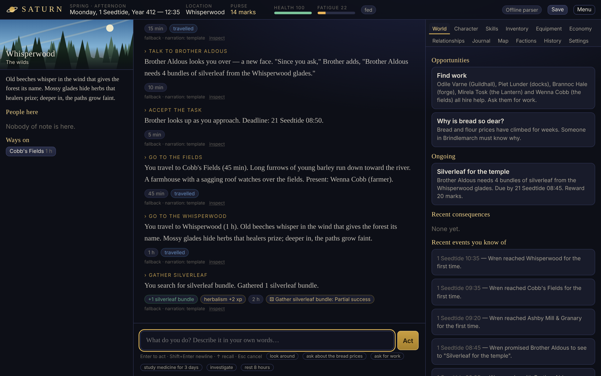

# SATURN — The Living World

An offline, AI-powered, open-ended text RPG. You describe what you want to do in your own
words; a **local** language model interprets your intent into structured proposals; an
**authoritative simulation engine** decides what is possible, rolls the dice, commits the
consequences, and keeps the world moving; the model then narrates what actually happened.

> The player's imagination decides what they may attempt. Skills, knowledge, resources,
> circumstances, opposition and luck decide what happens.

No accounts, no cloud, no telemetry, no network. Everything — the model, the inference
runtime, the database — runs on your machine.



## What you can do today (verified)

The first release ships one cohesive setting, **the Saltwind Reach**: the river-market town
of Brindlemarch, the fishing harbour of Kestrel Point, farmland, a whispering forest and a
lost observatory, under a sky crossed by the Great Ring.

- **Talk to anyone** with any approach: ask, persuade, flatter, deceive, intimidate, insult.
  NPCs only reveal what they actually know, and secrets are guarded by the people they concern.
- **Earn a living**: ask for work, take shifts, get paid from your employer's real purse.
- **Trade** in a market where prices come from merchants' real stock. Salt is cheap upriver and dear
  on the coast; haggle, run cargo, undercut rivals.
- **Learn** through study (books, mentors, the archive's reading room), drills, real use and
  experimentation — each with limits. Easy tasks teach nothing; grinding has diminishing returns.
- **Found a business** (bakery, brewhouse, fish-curing works, apothecary, river trading company)
  that buys inputs, produces, sells, pays rent and wages, and reports weekly. Borrow money, take investors.
- **Investigate**: the price of bread has been rising. Someone in town knows why.
- **Research and invent**: long projects resolved through repeated checks; completed
  inventions become new craftable items.
- **Steal, lie, fight** — with witnesses, fines, and reputations that spread by gossip.
- **Let time pass**: study for three months, and the world keeps simulating — NPCs follow schedules,
  hoard, undercut, gossip, go bankrupt, get arrested.

Every action is resolved by the **SATURN Resolution System** (2d10 + attribute + skill vs. a
target number, six degrees of success), with exact probabilities and modifiers visible in the
action inspector.

## Install (Windows)

Download the `SATURN-Setup-<version>` installer files from the release page (an `.exe` plus
`.bin` volumes — keep them in the same folder), run the `.exe`, then use the **SATURN** desktop
shortcut. Nothing else needs to be installed; no internet connection is needed or used.

**Minimum:** Windows 10/11 x64, 4-core CPU with AVX2, 8 GB RAM, 5 GB disk.
**Recommended:** 6+ cores or any Vulkan-capable GPU (NVIDIA, AMD, Intel), 16 GB RAM.
On CPU only, the Game Master takes roughly 10–40 seconds to interpret a complex free-form
instruction (see `docs/AI.md` for measured numbers); short commands are instant.
A "light" model profile is available for weaker machines.

> Status: the Windows build is produced by `scripts/package.mjs` and an Inno Setup script; the
> full installer is built and smoke-tested on a Windows runner by
> `.github/workflows/windows-release.yml`. See `docs/STATUS.md` for exactly what has and has not
> been verified.

## Play from source (any OS)

```bash
npm install
node scripts/fetch-model.mjs standard     # build/dev only: downloads the pinned model (2.5 GB, checksum-verified)
npm start                                 # desktop app (Electron)
npm run play                              # terminal client
npm run web                               # UI in your browser at http://127.0.0.1:7313 (local only)
```

Without a model, SATURN still plays with its deterministic parser and template narration.

## Develop

```bash
npm test                                  # 44 tests: rules, economy, memory, NPCs, persistence, AI reliability, acceptance
npm run soak -- 5000                      # long-campaign soak with continuous integrity checks
npm run bench                             # benchmark local models on SATURN's real tasks
node scripts/package.mjs --platform win32 --arch x64 --target dir    # Windows build
```

## Documentation

- `docs/ARCHITECTURE.md` — architecture and decision records
- `docs/AI.md` — model/runtime comparison, selection rationale, measured performance
- `docs/SIMULATION.md` — rules, probability, progression, economy, NPCs
- `docs/MEMORY.md` — the memory architecture
- `docs/PACKAGING.md` — building the offline Windows installer
- `docs/STATUS.md` — verified / partial / not implemented, test results, known limitations
- `docs/ROADMAP.md` — next milestones
- `THIRD_PARTY_NOTICES.md` — bundled components and licences
